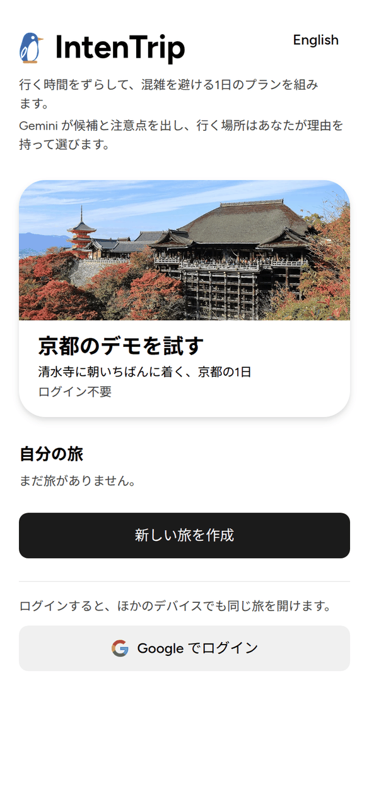
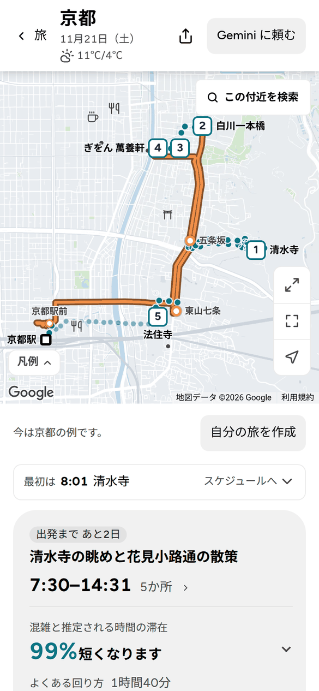
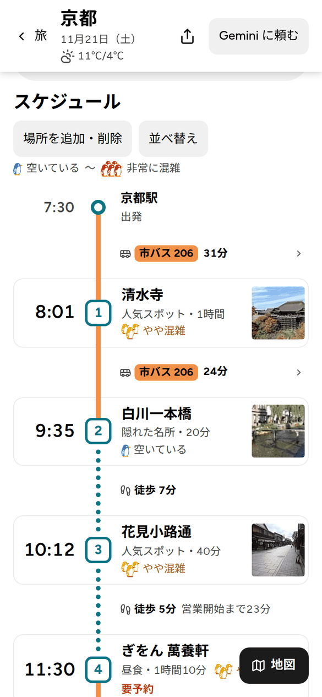
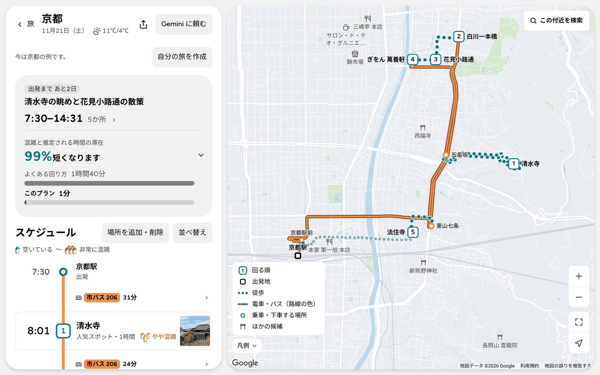
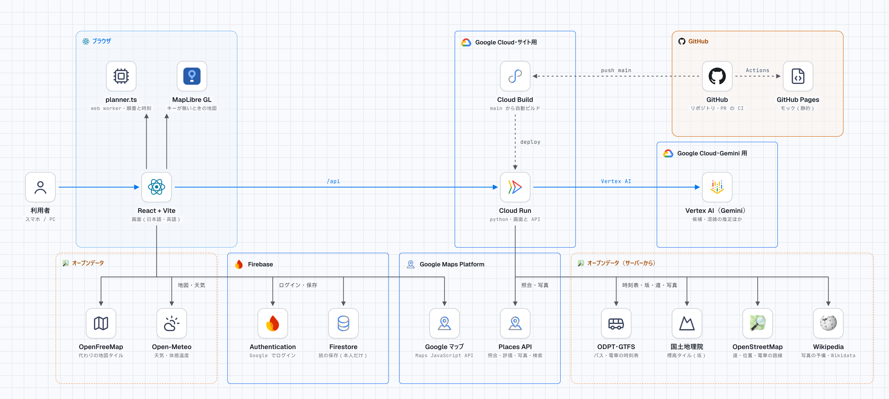

<div align="center">


# IntenTrip

**行く時間と場所をずらして、混雑を避ける旅行プランを作成する Web アプリ**

AI が候補を提示し、ユーザーが理由（Why）を決めてプランを作成する。

DevFest GDGoC Japan Hackathon 2026 ／ テーマ「Own the Why, Build with Intent」 ／ カテゴリ: 観光 ／ チーム: いいおゼミ（東京会場）

[](https://intentrip-29919508404.asia-northeast1.run.app/) [](https://cloud.google.com/vertex-ai) [](https://firebase.google.com/)<br>
[](https://react.dev/) [](https://www.typescriptlang.org/) [](https://vite.dev/) [](https://maplibre.org/) [](https://www.python.org/) [](https://pnpm.io/) [](https://docs.astral.sh/uv/)

[本番環境](https://intentrip-29919508404.asia-northeast1.run.app/) ・ [京都のデモ](https://intentrip-29919508404.asia-northeast1.run.app/?example&lang=ja) ・ [English](https://intentrip-29919508404.asia-northeast1.run.app/?lang=en) ・ [GitHub Pages 版](https://v76nl.github.io/devfest-hackathon-2026/)

</div>

| 項目 | 内容 |
|---|---|
| **デプロイ URL** | https://intentrip-29919508404.asia-northeast1.run.app/ ／ Google Cloud Run。Demo Day（11/27）まで稼働 |
| **動作確認** | ホーム画面の「京都のデモを試す」を押す（ログイン・設定は不要）。直接開く URL: https://intentrip-29919508404.asia-northeast1.run.app/?example |
| **対応するコミット** | 開発用リポジトリの最終コミット `88ad0acddb` |

<table>
  <tr>
    <td align="center" width="33%">
      <picture>
        <source media="(prefers-color-scheme: dark)" srcset="data/readme/home-dark.png">
        
      </picture>
      <br><sub>ホーム</sub>
    </td>
    <td align="center" width="33%">
      <picture>
        <source media="(prefers-color-scheme: dark)" srcset="data/readme/plan-dark.png">
        
      </picture>
      <br><sub>プラン・地図・混雑の比較</sub>
    </td>
    <td align="center" width="33%">
      <picture>
        <source media="(prefers-color-scheme: dark)" srcset="data/readme/schedule-dark.png">
        
      </picture>
      <br><sub>スケジュール</sub>
    </td>
  </tr>
  <tr>
    <td colspan="3" align="center">
      <picture>
        <source media="(prefers-color-scheme: dark)" srcset="data/readme/pc-dark.png">
        
      </picture>
      <br><sub>PC 表示</sub>
    </td>
  </tr>
</table>

<sub>スクリーンショットは本番環境の京都のデモ（<code>?example</code>）。写真: 清水寺 <a href="https://commons.wikimedia.org/wiki/File:Kiyomizu-dera,_Kyoto,_November_2016_-02.jpg">Martin Falbisoner</a>（CC BY-SA 4.0）・白川一本橋 <a href="https://commons.wikimedia.org/wiki/File:Gyouzyabashi.JPG">アラツク</a>（CC BY-SA 4.0）・花見小路通 <a href="https://commons.wikimedia.org/wiki/File:Gion_Hanamik%C3%B4ji-d%C3%B4ri.jpg">Yanajin33</a>（CC BY-SA 4.0）。いずれも Wikimedia Commons。地図データ ©2026 Google。</sub>

## 目次

- [概要](#概要)
- [機能](#機能)
- [アーキテクチャ](#アーキテクチャ)
- [使用した Google 技術](#使用した-google-技術)
- [AI の利用](#ai-の利用)
- [デプロイ環境](#デプロイ環境)
- [開発状況](#開発状況)
- [ローカル開発](#ローカル開発)
- [ディレクトリ構成](#ディレクトリ構成)
- [ドキュメント](#ドキュメント)
- [メンバー](#メンバー)
- [ライセンス](#ライセンス)

## 概要

DevFest GDGoC Japan Hackathon 2026 参加チーム「いいおゼミ」（df-2026-t080）の提出用リポジトリ。
テーマ「Own the Why, Build with Intent」（カテゴリ: 観光）のもとで、Web アプリ「IntenTrip」を開発した。有名観光地への集中（オーバーツーリズム）による混雑を避けながら、街歩きや穴場スポットを自分の意志で選んで巡るプランを作成できる。対象は、日帰りから3泊4日の旅。

- AI（Gemini）が、実在するスポットの候補を特徴と注意点付きで提示し、時間帯ごとの混雑を推定する
- ユーザーが訪問先を自分で選び、選んだ理由を記録する
- 訪問時刻と順序は Gemini に生成させず、ブラウザ上（Web Worker）で計算する（実行できないスケジュールの生成を防ぐため）

訪日外国人は2025年に過去最多の4,268万人になり、国も「観光客が集中する一部の地域や時間帯等によっては、……地域住民の生活への影響や、旅行者の満足度低下への懸念が生じています」としている。混雑で困った旅行者の約4割が、その原因を「情報不足」と答えている（出典は [docs/problem-evidence.md](docs/problem-evidence.md)）。

## 機能

|機能|説明|
|--|--|
| 訪問先の選択 | エリアと希望を入力すると、Gemini が人気スポット・隠れた名所・飲食店・カフェの候補を提示する。候補の生成中は、エリアの見どころと店舗を表示する |
| 混雑を避けたスケジュール | 混雑の推定・所要時間・営業時間をもとに、混雑する時間帯と場所を避けた1日のスケジュールを作成する。「よくある回り方」と比べた、混雑する場所での滞在時間の差を2本のバーで表示する |
| 宿泊を伴う旅 | 1日単位のプランを、最大3泊4日の1つの旅にまとめる。行き先・泊数・日付・宿・希望は、1行のテキストから抽出する。1日に収まらないスポットは翌日に繰り越す |
| 車での移動 | レンタカーでの周遊プランに対応する |
| 公共交通機関 | ODPT（公共交通オープンデータ）の時刻表から、実際の便と所要時間の目安を表示する。時刻表の無い区間は、OpenStreetMap の路線データによる目安・Google マップへのリンク・乗換案内のスクリーンショットの読み取りで補う |
| 旅行中・旅行後 | 旅のミッションと写真を記録する。案内役のペンギンの一言（その日の注意点）を表示する。旅行後は、選んだ理由と写真を1枚にまとめて振り返る |
| 保存と共有 | Google ログインで旅をクラウドに保存する（任意）。地図とスケジュールを画像として保存・共有する |
| 多言語対応 | 日本語と英語に対応する（UI・Gemini の生成文・京都のデモを含む） |

## アーキテクチャ

<picture>
  <source media="(prefers-color-scheme: dark)" srcset="data/architecture-dark.png">
  
</picture>

<sub>システム構成図（2026-11-09 時点の構成。Google Cloud の製品は公式アイコンで表記）。<a href="data/architecture.png">ライト版</a> / <a href="data/architecture-dark.png">ダーク版</a></sub>

|領域|技術|
|--|--|
| フロントエンド | React 19, TypeScript, Vite。UI コンポーネントは Astryx（StyleX）。地図は Google Maps JavaScript API を使用（API キーが未設定、または読み込みに失敗した場合は MapLibre GL にフォールバック） |
| バックエンド | Python 3.13, Gemini (Vertex AI, google-genai)。フロントエンドの静的ファイルと API を同一サーバーから配信 |
| スポット情報 | Places API (New) で候補の位置・写真・評価・営業時間を照合。位置の検証と写真のフォールバックに Nominatim・Wikipedia・Wikidata を使用 |
| 公共交通機関 | ODPT（公共交通オープンデータ）の時刻表から、バス・電車の実際の便と所要時間の目安を算出。時刻表が無いエリアでは、OpenStreetMap の路線データ (Overpass API) による電車の目安、推定式による目安、Google マップへのリンク、乗換案内のスクリーンショットの読み取りで補完 |
| 経路と標高 | 徒歩・車の所要時間と経路は OSRM、坂の判定は国土地理院の標高タイル |
| 認証とデータ保存 | Firebase Authentication（Google ログイン）と Cloud Firestore（旅の保存） |
| 実行基盤 | Cloud Run (`asia-northeast1`)。`main` へのマージで Cloud Build が自動デプロイ。公開 URL: [intentrip-29919508404.asia-northeast1.run.app](https://intentrip-29919508404.asia-northeast1.run.app/) |
| パッケージマネージャー | pnpm (Web), uv (Server) |

候補の収集・スケジュールの算出・時刻表の処理の詳細は [web/README.md](web/README.md) の「仕組み」を参照。

## 使用した Google 技術

| 技術 | 用途 |
|---|---|
| **Cloud Run**（実行基盤） | フロントエンドと API を1つのコンテナで配信。リクエストが無い間は課金されない |
| **Vertex AI（Gemini）** | 候補の生成（特徴と注意点）、混雑の推定、プラン変更の指示の解釈、その日の注意点（ペンギンの一言）、ミッションの生成、乗換案内のスクリーンショットの解析、宿泊を伴う旅の入力（1行のテキスト）の解析 |
| **Maps JavaScript API** | 地図の表示（API キーがある場合。無い場合は MapLibre GL にフォールバック） |
| **Places API (New)** | Gemini が生成した候補の照合（位置・場所の種類）と、臨時休業・閉業のスポットの除外。候補の写真・評価・営業時間と、一覧のサムネイルの表示（地図に Google Maps JavaScript API を使用している場合のみ。本番環境で有効） |
| **Firebase Authentication・Cloud Firestore** | Google アカウントでのログイン（任意）と、旅のクラウド保存（本人のみ読み書きできるセキュリティルール: [`firestore.rules`](firestore.rules)） |

技術選定の理由と、不採用とした案: [docs/tech-choices.md](docs/tech-choices.md)

## AI の利用

- **プロダクト内**: Gemini は「候補の提示・混雑の推定・文章の生成」に使用する。**時刻の計算・訪問順・最終的な選択は、AI に行わせない**（ルールとユーザーが決める）。AI が生成した文には、生成であることが分かる印を付ける。
- **開発**: 実装・調査・ドキュメントの下書きに Claude（Claude Code）を使用した。何を作るか、どの案を採用するかは、チームのメンバーが決めた。
- 場面ごとの詳細は [docs/ai-usage.md](docs/ai-usage.md)、Gemini に送信するプロンプトの全文は [docs/prompts.md](docs/prompts.md)。

## デプロイ環境

|環境|説明|
|--|--|
|Cloud Run|本番環境。Gemini (Vertex AI) を利用できる。Gemini 用とアプリの配信用で、Google Cloud のプロジェクトと請求先アカウントを分けている|
|GitHub Pages|[v76nl.github.io/devfest-hackathon-2026](https://v76nl.github.io/devfest-hackathon-2026/) 。サーバーを使わない静的モードで、京都のデモを公開している。地図は MapLibre GL を使用する。開発用リポジトリからデプロイしている|
|ローカル|`python run.py` 。`.env` に自分の Gemini API キーを設定すると、Gemini を利用できる|

Cloud Run へのデプロイ手順は [web/README.md](web/README.md) の「Cloud Run に置く」を参照。プロジェクト ID などの識別子は、このリポジトリには記載していない。

## 開発状況

- 予選までの実装: 訪問先を選ぶフロー、候補の収集と混雑を避けたスケジュールの作成、選んだ理由の入力、旅のミッションと写真の記録、旅行と幸福の研究を反映したプランの作成（締めくくり・ゆとり・楽しみ）、地図 (MapLibre GL / Google Maps JavaScript API)、Places API (New) の写真・評価・営業時間、ODPT の時刻表によるバス・電車の便と所要時間、乗換案内のスクリーンショットの読み取り、Gemini によるプランの調整、旅の振り返り、地図とスケジュールの画像の保存、英語への切り替え、Google ログインと旅のクラウド保存 (Firebase Authentication・Cloud Firestore)、ホーム画面、出発地・到着地の入力、坂の注意表示、出典の表示、京都のデモ、CI
- 予選後の追加（開発用リポジトリの PR #263〜#356）:
  - 宿泊を伴う旅 (#267・#271〜#275・#285)
  - 車での移動 (#288・#289)
  - 候補の一覧への Places API (New) の写真の表示（#286）、京都のデモへの写真の追加（#290）
  - 候補の生成中に表示する見どころと店舗 (#269・#270)
  - 電車区間の路線名・経路・路線色の表示 (#268)、位置を検証できなかった候補の除外 (#264)、Google マップで臨時休業・閉業のスポットの除外 (#341)
  - 都道府県名だけの出発地を県庁所在地の主要駅として扱う処理 (#280・#284)
  - 「服装の目安」と「ペンギンの一言」の役割の分離（#353・#354）
  - UI の文言とデザインの見直し（#263・#265、#291 以降の UI の PR）
- 設計上の制約: レート制限のカウントとジョブの進捗をサーバーのメモリに保持する設計のため、Cloud Run の最大インスタンス数は 1。ログは標準出力から Cloud Run に出力する（構造化ログと稼働監視は今後の拡張）
- 実装状況の一覧（根拠となるファイル付き）は [docs/implementation-status.md](docs/implementation-status.md) を参照
- バス・電車の実際の便は、時刻表データ（ODPT）があるエリアで表示する。時刻表が無いエリアは、OpenStreetMap の路線データによる目安と Google マップへのリンクで補完する

## ローカル開発

必要な環境: Python 3.9 以上、[uv](https://docs.astral.sh/uv/)、[pnpm](https://pnpm.io/)。

|コマンド|説明|
|--|--|
|`python run.py`|フロントエンドのビルドからサーバーの起動までを一括で実行 (http://localhost:8124)。初回は依存関係もインストール|
|`python run.py --dev`|フロントエンドの開発サーバー (http://localhost:5173) とバックエンドサーバーを同時に起動|
|`python run.py --skip-build`|ビルド済みの `web/dist` を使用し、サーバーのみ起動|
|`cd web && pnpm install && pnpm build`|フロントエンドの依存関係のインストールとビルド|
|`cd web && pnpm dev`|フロントエンドの開発サーバーを起動（HMR 対応）|
|`cd server && uv venv && uv pip install -r requirements.txt`|サーバー側の仮想環境 (.venv) の作成とパッケージのインストール|
|`cd server && uv run python app.py`|サーバーの起動 (http://localhost:8124)|

※ 起動手順と Gemini の環境変数の詳細は [web/README.md](web/README.md) を参照。

### Gemini の設定 (.env)

1. `.env.example` を `.env` にコピーする（`.env` は Git の管理対象外）。
2. 自分の Gemini API キー（[AI Studio](https://aistudio.google.com/apikey)）を `GEMINI_API_KEY` に、使用するモデル名を `ZT_MODEL` に設定する。
3. `python run.py` を実行する（起動時に `.env` を読み込む）。

Vertex AI（本番環境と同じ構成）を使う場合は、`.env.example` の方式 B を使用する。API キーは共有・コミットしない。AI Studio の API キーはローカル開発用で、本番環境では Vertex AI を使用する。

バス・電車の便を表示するには、ODPT の開発者サイトで発行した API キー（アクセストークン）を `ZT_ODPT_KEY` に設定する（未設定の場合、便は表示されない）。

### テスト

|コマンド|説明|
|--|--|
|`cd web && pnpm typecheck`|フロントエンドの型チェック|
|`cd web && node --test tests/geo-cutoff.test.mjs tests/line-edge.test.mjs tests/photo-load.test.mjs tests/quiet-hint.test.mjs`|フロントエンドのテスト（CI で実行しているもの）|
|`cd server && python -m unittest discover -s tests`|サーバーのテスト（Gemini・Places API・時刻表はモックに差し替えるため、API キーもネットワーク接続も不要）|

開発用リポジトリでは、PR ごとに `.github/workflows/ci.yml` が、フロントエンドの型チェック・ビルド・テスト、サーバーの構文チェックとテスト、Docker イメージのビルドを実行する。

## ディレクトリ構成

<details>
<summary>ファイルツリーを表示</summary>

```text
df-2026-t080
├── .github/workflows/                - GitHub Actions
│   └── ci.yml                        - PR 時に型チェック・ビルド・テスト・Docker イメージのビルドを実行
│
├── data/                             - 企画・調査・計画のドキュメント (コードは含まない)
│   ├── theme.md                      - プロダクト「IntenTrip」の詳細仕様書
│   ├── idea.md                       - アイデアの発散と検討ログ
│   │
│   ├── maps-and-gemini-research.md   - Google Maps API・Gemini 連携の調査資料
│   ├── travel-happiness-research.md  - 旅行と幸福に関する研究の調査
│   ├── happiness-in-app.md           - 旅行と幸福の研究のアプリへの反映
│   ├── ui-guidelines.md              - UI デザインのガイドライン
│   ├── auth-and-trips.md             - 認証と旅のクラウド保存 (Firebase)
│   │
│   ├── architecture.png              - システム構成図 (ライト版)
│   ├── architecture-dark.png         - システム構成図 (ダーク版)
│   └── readme/                       - README 用のスクリーンショット
│
├── server/                           - バックエンド (Python)。フロントエンドの静的ファイルと API を配信
│   ├── app.py                        - サーバー本体 (API・静的ファイルの配信・ジョブの進捗・レート制限)
│   ├── gemini.py                     - Gemini (Vertex AI) の呼び出し
│   ├── webconfig.py                  - フロントエンドに渡す実行時の設定 (Firebase の設定など)
│   │
│   ├── places.py                     - スポット候補の収集・混雑推定のプロンプト
│   ├── preview.py                    - 候補の生成中に表示する見どころと店舗
│   ├── gplaces.py                    - Places API (New) の呼び出し
│   ├── enrich.py                     - Wikipedia の写真の取得・OSRM による所要時間の計算
│   ├── elev.py                       - 徒歩経路の高低差 (国土地理院の標高タイル)
│   │
│   ├── adjust.py                     - プランへの要望 (「もっとゆっくり」など) を UI の操作に変換
│   ├── tripask.py                    - 宿泊を伴う旅の1行のテキストから旅の条件を抽出
│   ├── odai.py                       - 旅のミッションの生成 (Gemini)
│   ├── penguin.py                    - ペンギンの一言 (その日の注意点)
│   ├── transit.py                    - 乗換案内のスクリーンショットの解析
│   │
│   ├── bus.py                        - 時刻表 (GTFS) から乗換なしの便を検索
│   ├── bus_feeds.py                  - エリアに該当する時刻表の選択
│   ├── bus_catalog.json              - ODPT の時刻表ごとの停留所の範囲
│   ├── rail.py                       - OpenStreetMap の路線データによる電車の所要時間の目安
│   ├── rail_seed/                    - 同梱の路線データ (大阪の中心部。ODbL)
│   │
│   ├── sample.json                   - 京都のデモのデータ (静的モードでも使用)
│   ├── sample.en.json                - 京都のデモのデータ (英語)
│   ├── requirements.txt              - Python の依存パッケージ
│   └── tests/                        - サーバーのテスト
│
├── web/                              - フロントエンド (React + TypeScript + Vite)
│   ├── README.md                     - 詳細ドキュメント (アーキテクチャ・Cloud Run へのデプロイ手順)
│   ├── index.html                    - エントリーポイントの HTML
│   ├── package.json                  - 依存パッケージとスクリプト
│   ├── pnpm-lock.yaml                - ロックファイル
│   ├── vite.config.ts                - Vite の設定 (/api をローカルのサーバーにプロキシ)
│   ├── astryxCssPrune.ts             - 未使用の Astryx の CSS を削除する Vite プラグイン
│   ├── public/                       - アイコン・OGP 画像
│   ├── tests/                        - フロントエンドのテスト
│   │
│   └── src/                          - フロントエンドのソースコード
│       ├── main.tsx                  - エントリーポイント
│       ├── App.tsx                   - アプリ全体の構成と状態管理
│       ├── types.ts                  - スポット・プランなどの型定義
│       ├── styles.css / app.css      - スタイル
│       ├── themes/                   - Astryx のテーマ
│       │
│       ├── components/               - UI コンポーネント
│       │                               (ホーム、旅の作成、候補・スポットの詳細、スケジュール、
│       │                                地図: MapView / GoogleMapView、ミッション、振り返りなど)
│       │
│       ├── lib/                      - UI 以外のロジック
│       │   ├── api.ts                - サーバー API の呼び出し
│       │   ├── planner.ts            - スケジュールの算出 (時刻の計算は Gemini に任せない)
│       │   ├── planWorker.ts         - スケジュールの計算を Web Worker で実行
│       │   ├── usePlan.ts            - 入力の変更ごとにバックグラウンドで再計算
│       │   ├── days.ts               - 宿泊を伴う旅の日ごとの状態
│       │   ├── carTrip.ts            - 車での移動
│       │   ├── crowd.ts              - 混雑度の処理
│       │   ├── geo.ts                - 所要時間の目安・Google マップへのリンク
│       │   ├── gmaps.ts              - Google Maps JavaScript API の読み込み
│       │   ├── mapLayer.ts           - 2つの地図で共通のラベルのレイヤー
│       │   ├── odai.ts               - 旅のミッション (保存・再生成・写真)
│       │   ├── why.ts                - 選んだ理由 (保存・読み出し)
│       │   ├── recap.ts              - 旅の振り返りのカード
│       │   ├── i18n.ts               - 日本語と英語の翻訳
│       │   ├── auth.ts               - Google ログイン (Firebase Authentication)
│       │   ├── firestore.ts          - 旅のクラウド保存 (Cloud Firestore)
│       │   ├── photo.ts              - Wikipedia の写真の URL
│       │   ├── weather.ts            - 天気予報 (Open-Meteo)
│       │   ├── time.ts               - 時刻・日付・祝日
│       │   └── ……                    - その他
│       │
│       └── data/                     - フロントエンドが読み込む静的データ
│           ├── odai.json             - ミッションの例 (スポットの種類ごと)
│           └── odai.en.json          - ミッションの例 (英語)
│
├── docs/                             - 提出ドキュメント
│   ├── description.md                - プロダクト説明ドキュメント
│   ├── implementation-status.md      - 実装状況の一覧
│   ├── tech-choices.md               - 技術選定の理由
│   ├── ai-usage.md                   - AI の利用場面
│   ├── prompts.md                    - Gemini に送信するプロンプトの一覧
│   ├── problem-evidence.md           - 課題の根拠と出典
│   └── third-party.md                - 素材・ライブラリ・データの出典とライセンス
│
├── submission/
│   └── eval/                         - 混雑を避ける効果の試算
│
├── Dockerfile                        - Cloud Run 用 (フロントエンドとサーバーを1つのコンテナにまとめる)
├── .dockerignore / .gcloudignore     - コンテナ・アップロードの除外設定
├── firebase.json / firestore.rules   - Cloud Firestore のセキュリティルールとローカルの Emulator の設定
├── .env.example                      - ローカル実行用の設定のテンプレート (.env は Git の管理対象外)
├── run.py                            - ビルドとサーバーの起動を一括で実行 (Windows / macOS 共通)
│
├── LICENSE                           - MIT License
└── README.md
```

</details>

## ドキュメント

| ファイル | 内容 |
|---|---|
| [docs/description.md](docs/description.md) | プロダクト説明ドキュメント（運営の指定様式の1〜9） |
| [docs/implementation-status.md](docs/implementation-status.md) | 実装状況の一覧（根拠となるファイル付き） |
| [docs/tech-choices.md](docs/tech-choices.md) | 技術選定の理由 |
| [docs/ai-usage.md](docs/ai-usage.md) | AI の利用場面と、AI の提案を採用しなかった場面 |
| [docs/prompts.md](docs/prompts.md) | Gemini に送信するプロンプトの一覧 |
| [docs/problem-evidence.md](docs/problem-evidence.md) | 課題の根拠と出典 |
| [submission/eval/README.md](submission/eval/README.md) | 混雑する時間帯を避ける効果の試算（8エリア・128通り）。混雑の推定を京都の公開予測と照合した記録は [crowd-check.md](submission/eval/crowd-check.md) |
| [docs/third-party.md](docs/third-party.md) | 使用した素材・ライブラリ・データの出典とライセンス |
| [data/auth-and-trips.md](data/auth-and-trips.md) | ログインと旅の保存（Firebase）の設計 |
| [data/travel-happiness-research.md](data/travel-happiness-research.md)・[data/happiness-in-app.md](data/happiness-in-app.md) | 旅行と幸福に関する研究と、アプリへの反映 |
| [data/maps-and-gemini-research.md](data/maps-and-gemini-research.md) | Google Maps Platform と Gemini の調査 |
| [data/ui-guidelines.md](data/ui-guidelines.md) | UI ガイドライン |
| [web/README.md](web/README.md) | フロントエンド・サーバーの起動方法と、Cloud Run へのデプロイ手順 |

## メンバー

<table>
  <tr>
    <td align="center"><a href="https://github.com/v76nl"><br><sub><b>@v76nl</b></sub></a><br><sub>Leader</sub></td>
    <td align="center"><a href="https://github.com/karinkamonohashi"><br><sub><b>@karinkamonohashi</b></sub></a></td>
    <td align="center"><a href="https://github.com/Shichimi555"><br><sub><b>@Shichimi555</b></sub></a></td>
    <td align="center"><a href="https://github.com/Omupp"><br><sub><b>@Omupp</b></sub></a></td>
  </tr>
</table>

## ライセンス

MIT License（[LICENSE](LICENSE)）。
