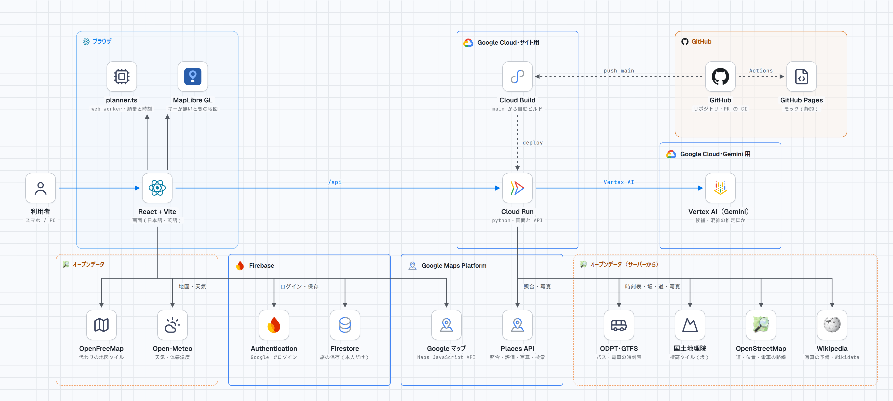

# IntenTrip（インテントリップ）

**混雑を避けた旅程を、AI が複数の候補（注意点つき）で出し、人が理由を添えて選ぶ旅のアプリ。**

DevFest GDGoC Japan Hackathon 2026 ／ テーマ「Own the Why, Build with Intent」 ／ カテゴリ: 観光 ／ チーム: いいおゼミ（東京会場）

|  |  |
|---|---|
| **デプロイした作品** | https://intentrip-29919508404.asia-northeast1.run.app/ （Google Cloud Run。Regional Day〔11/14〕まで動かし続ける） |
| **まず試すには** | 開いて「京都のデモを試す」を押す（ログイン・設定は要らない）。直リンクは https://intentrip-29919508404.asia-northeast1.run.app/?example |
| **この内容の元** | 開発用リポジトリの最終コミット `55123db076` |
| **メンバー** | [@v76nl](https://github.com/v76nl)・[@Omupp](https://github.com/Omupp)・[@Shichimi555](https://github.com/Shichimi555)・[@karinkamonohashi](https://github.com/karinkamonohashi) |

## 何を解決するか

日帰り〜1 泊の旅行者（学生・若年層が中心）が、有名な場所に集中して**混雑で疲れ**、**穴場を探す時間もない**。
訪日外国人は 2025 年に過去最多の 4,268 万人になり、国も「観光客が集中する一部の地域や時間帯等によっては、……地域住民の生活への影響や、旅行者の満足度低下への懸念が生じています」としている。混雑で困った旅行者の約 4 割が、その原因を「情報不足」と答えている（出典は [docs/problem-evidence.md](docs/problem-evidence.md)）。

## どう解決するか（Own the Why）

1. 新しい旅は、**行きたい場所を自分で選ぶ**ところから始まる（いきなり答えを出さない）。
2. AI（Gemini）が、実在する候補を、**特徴と注意点（欠点）**つきで出す。人は、欠点を見たうえで選び、**選んだ理由を一言残す**。
3. 混雑を避けた**時間割**を、規則で組む（時刻の計算は AI にさせない）。一日の最後を落ち着いた場所で終える、場所の間にゆとりを入れる、旅の前の「楽しみ」を出す、など、旅と幸福の研究を入れてある。
4. 移動は、**本物のバス・電車の便**と目安時間（公共交通オープンデータ ODPT）、Google マップへのリンク。
5. 旅の最中は、**ミッションと写真**（1 つの物をじっくり見て 1 枚撮る）。旅のあとは、**選んだ理由と写真を、1 枚のカードにして振り返る**（画像で保存）。地図とスケジュールも、1 枚の画像で保存できる。画面・Gemini の文は、日本語と英語に対応。

## 構成図



画面（React・Vite）と API（Python）を 1 つのコンテナにまとめ、Cloud Run で配信している（[`Dockerfile`](Dockerfile)）。

## 使っている Google 技術

| 技術 | 使い方 |
|---|---|
| **Cloud Run**（実行基盤） | 画面と API を 1 つのコンテナで配信。リクエストが無い間は課金されない |
| **Vertex AI（Gemini）** | 候補の収集（特徴と注意点）、混雑の推定、プランへの頼みの解釈、その日の注意（ペンギンの一言）、ミッション、乗換スクリーンショットの読み取り |
| **Maps JavaScript API** | 地図（キーがあるとき。無いときは MapLibre） |
| **Places API (New)** | 候補の写真・評価・営業時間（Google マップが地図のときだけ表示。本番で有効） |
| **Firebase Authentication・Cloud Firestore** | Google のログイン（任意）と、旅のクラウド保存（本人だけが読み書きできるルール: [`firestore.rules`](firestore.rules)） |

技術を選んだ理由と、捨てた案: [docs/tech-choices.md](docs/tech-choices.md)

## AI の使いどころ

- **製品の中**: Gemini は「候補を出す・推定する・言葉にする」ことに使う。**時刻の計算・回る順番・最終的な選択は、AI にさせない**（規則と人が決める）。AI が作った文には、そうと分かる印を付ける。
- **開発**: 実装・調査・文書の下書きに Claude（Claude Code）を使った。何を作るか、どの案を採るかは、人が決めた。
- 場面ごとの詳しい説明は [docs/ai-usage.md](docs/ai-usage.md)、Gemini に送っている指示の全文は [docs/prompts.md](docs/prompts.md)。

## ドキュメント

| ファイル | 中身 |
|---|---|
| [docs/description.md](docs/description.md) | プロダクト説明ドキュメント（運営の様式の 1〜9） |
| [docs/implementation-status.md](docs/implementation-status.md) | 実装済み／一部／未実装の表（根拠のファイルつき） |
| [docs/tech-choices.md](docs/tech-choices.md) | 技術選定の理由 |
| [docs/ai-usage.md](docs/ai-usage.md) | AI の使いどころと、AI の提案を採らなかった場面 |
| [docs/prompts.md](docs/prompts.md) | Gemini に送るプロンプトの一覧 |
| [docs/problem-evidence.md](docs/problem-evidence.md) | 課題の根拠と出典 |
| [submission/eval/README.md](submission/eval/README.md) | 混む時間を避ける効果の試算（8 エリア・128 通り）。推定を京都の公開の予測と照らした記録は [crowd-check.md](submission/eval/crowd-check.md) |
| [docs/third-party.md](docs/third-party.md) | 使った素材・ライブラリ・データの出典とライセンス |
| [data/auth-and-trips.md](data/auth-and-trips.md) | ログインと旅の保存（Firebase）の設計 |
| [data/travel-happiness-research.md](data/travel-happiness-research.md)・[data/happiness-in-app.md](data/happiness-in-app.md) | 旅と幸福の研究と、アプリへの入れ方 |
| [data/maps-and-gemini-research.md](data/maps-and-gemini-research.md) | Google Maps Platform と Gemini の調査 |
| [data/ui-guidelines.md](data/ui-guidelines.md) | 画面の見やすさの指針 |
| [web/README.md](web/README.md) | 画面・サーバーの動かし方と、Cloud Run への置き方 |

## 実装の状況（正直に）

[docs/implementation-status.md](docs/implementation-status.md) に、実装済み／一部／未実装を、根拠のファイルつきで書いた。**一部**: バス・電車の便は、時刻表があるエリアのみ。**未実装**: 稼働監視、複数台での動作。

## 動かし方（手元）

必要なもの: Python 3.9 以上、[uv](https://docs.astral.sh/uv/)、[pnpm](https://pnpm.io/)。

```bash
python run.py            # 画面をビルドして、http://localhost:8124 で起動
```

- Gemini を使うには、`.env.example` を `.env` にコピーして埋める（自分の Gemini API キー、または Vertex AI の設定）。**`.env` はコミットしない。** 設定しなくても、京都の例のプランは動く。
- 詳しくは [web/README.md](web/README.md)。

## ライセンス

MIT License（[LICENSE](LICENSE)）。
