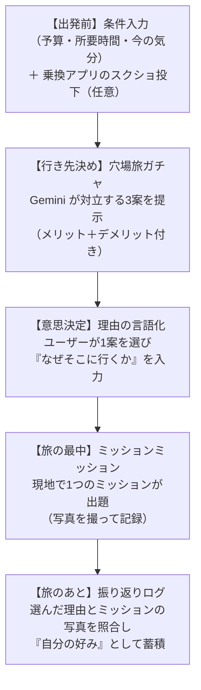

# 最終決定テーマ：旅ガチャ＆意思決定ログ（仮）

DevFest GDGoC Japan Hackathon 2026 のプロダクト開発において、チームで検討・合意した「旅・観光」関連のアイデアを1つに統合した最終決定テーマの仕様書です。

---

## 1. プロダクト概要

- **プロダクト名（仮）**: **WhyTrip**（または **IntentTrip** / **理由で旅するガチャ**）
- 「スマホのブラウザで開くことを前提にした、レスポンシブなWebアプリ（モバイルファーストWeb）」 として開発
- **対象カテゴリー**: **観光**（一部エンターテインメント・クリエイティブの要素を含む）
- **対象とする旅のスケール**:
    - **メイン**: **日帰り 〜 1泊2日 の「小さな旅」（マイクロツーリズム・街歩き探索）**
        - 例: 「週末の鎌倉」「谷中・根津・千駄木の路地裏探索」「下北沢の古着・カフェ巡り」「川越の日帰り散策」など、町の中を深くミクロに歩き回る体験。
    - **サブ（将来的な拡張）**: 長期休暇の大型旅行や遠出も同一の思想・システムでカバー可能。
- **一言コンセプト**:  
  **「AI が候補を出し、人間が理由を決めて旅に出る —— 意志（Why）で楽しむミクロな穴場旅ガチャ」**
- **コア体験**:  
  AI に行き先を丸投げするのではなく、AI が提示する「対立する3つの穴場候補（欠点付き）」の中から、**ユーザー自身が「なぜそこに行くのか」の理由を一言決めて出発する**。旅の最中は現地ならではの小さなミッションをこなし、帰宅後に「自分の選んだ理由」と写真で好みを振り返る。

---

## 2. ハッカソンテーマ「Own the Why, Build with Intent」への回答

本ハッカソンの審査基準である「人間が主導権を握る姿勢」「誰のどんな課題を解決するか」「AIの活用理由」に以下のように直結しています。

| ハッカソンテーマの要件 | 本プロダクトでの具現化 |
| :--- | :--- |
| **人間が主導権を握る** | AI は選択肢の提示とメリット・デメリットの整理に徹し、**最終決定と「選んだ理由（Why）」は必ず人間が入力**しないと出発（ルート案内）できない。 |
| **思考の所有権・意志の保持** | 単なるランダムなガチャではなく、「なぜそこに行きたいのか」「何を優先して何を諦めるか」を自問自答させ、旅の動機を言語化させる。 |
| **明確な課題解決** | ①「どこに行けばいいか決められない（休日の暇つぶし迷子）」 ②「有名観光地のオーバーツーリズム・混雑に疲れる」 ③「学生の予算・時間の制約（金はないが時間は使いたい）」を同時に解決する。 |
| **AI の活用理由と自己の成長** | 2億5,000万件以上の実データから穴場を抽出し、人間には思いつかない対立軸を提示する壁打ち相手として AI（Gemini / Places API）を必然性を持って活用する。 また、複雑な乗換案内APIを自作する代わりに、**普段使いの乗換アプリのスクショを Gemini の画像認識で解析させる**スマートなハックを導入。 |

---

## 3. 旅の流れに沿った体験フロー（全体像）

旅の時系列に沿って、これまでに挙がったアイデアを以下のステップに統合します。

### ステップ詳細

| 段階 | 機能名称 | ユーザー体験とシステムの挙動 | 統合元アイデア |
| :--- | :--- | :--- | :--- |
| **1. 出発前** | **制約・気分の入力** | ユーザーが「予算（例: 2,000円）」「所要時間（例: 半日）」「気分（例: 静かな路地を歩きたい、名物B級グルメを食べたい）」を入力する。 ※移動手段については、普段使いの乗換案内アプリのスクショを投げるだけで所要時間・交通費を自動認識。 | 学生の予算制約、曖昧な要望への対応、乗換スクショ解析 |
| **2. 行き先決め** | **対立3案の旅ガチャ** | 現在地周辺や指定エリア（例: 鎌倉・吉祥寺など）から、Google Maps の実データに基づき「穴場スポット」を抽出。Gemini が**あえて対立する3案（近い／遠い、屋内／屋外、予算内／あえて予算オーバー等）を「欠点・デメリット付き」で提示**する。 | 穴場を引く旅ガチャ、理由を書く旅ガチャ |
| **3. 意思決定** | **「理由」の入力と出発** | ユーザーは1案を選択し、**「なぜここを選ぶのか」の理由を一言入力（または音声入力・選択肢で補佐）する**。入力が完了すると Google マップのルートが開く。 | 理由を書かないと出発できない旅ガチャ |
| **4. 旅の最中** | **現地のミッションミッション** | 移動中や現地到着時に、その街・スポットならではの小さなミッションが1つ出題される（例:「地元の個人商店で名物を1つ買う」「一番古い路地の写真を撮る」）。ユーザーは写真を撮影して記録する。 | 旅行中のミッション、交差点でミッションが出る散歩 |
| **5. 旅のあと** | **好みの言語化・ログ** | 帰宅後、「出発前に書いた理由」と「現地で撮った写真」を振り返り、「実際どうだったか」を1タップで記録。旅のログが重なり、**「自分は何に惹かれる人間なのか（自分の好み）」が可視化**される。 | 推し活の言語化、意思決定ログ、好みの明文化 |

---

## 4. 統合した旅系アイデアの詳細仕様

### 4-1. 「ミクロな探索」を主軸にした街歩き・穴場抽出

- **ターゲットとする旅**: 日帰りや1泊2日の気軽な旅（鎌倉、川越、下北沢、清澄白河、あるいは身近な隣町の散策）。
- **穴場判定ロジック**:
    - Places API (New) の `rating`（評価平均）と `userRatingCount`（口コミ数）を活用。
    - **穴場判定条件**: 「評価 4.0 以上」かつ「口コミ数が適度（例: 15〜80件前後）」。大通り沿いの超有名店ではなく、一本路地に入った名店や個人商店を優先。
    - **混雑推定**: 営業時間・曜日・店舗カテゴリの実データを材料に、Gemini が「〇曜日のこの時間帯は比較的空いていると推測されます（※実データからのAI推定）」と根拠付きで提示。

### 4-2. 対立3案の提示と「欠点」の開示

- 単に良いところだけを並べるのではなく、Gemini が各案のトレードオフ（代償）を提示する。
    - **案A（手軽派）**: 徒歩10分で行けるが、席数が少なく長居はしにくい小さな隠れ家カフェ。
    - **案B（冒険派）**: 電車・バスを乗り継いで30分かかるが、観光客がほぼいない絶景の切り通し・寺院。
    - **案C（あえて予算超え）**: 予算2,000円を少し超える（2,500円）が、体験価値が非常に高い限定ランチ。
- **狙い**: 「欠点」があるからこそ、人間が「時間がないからA」「今日は冒険したいからB」「500円オーバーでも価値があるからC」と**主体的に意志を持って選ぶ必然性**が生まれる。

### 4-3. 外部乗換アプリの「スクショ投下」による時刻・運賃の取得（Gemini 画像認識）

- **背景と課題**:
    - 日本国内の鉄道・バスの乗換案内APIやリアルタイム時刻表APIは、法人向け契約が高額であったり個人開発では利用制限が厳しい。
    - 一方で、ユーザーは既に「Yahoo!乗換案内」「駅探」「NAVITIME」「Google マップ」など使い慣れたアプリをスマホに入れている。
- **解決アプローチ（スクショ × Gemini マルチモーダル）**:
    - ユーザーが乗換アプリで検索した結果の**スクリーンショット画像をアップロードするだけ**で、Gemini の画像認識（Multimodal Vision）が以下を即座に構造化抽出する。
    1. **出発時刻・到着時刻**（現地での滞在可能時間の把握）
    2. **乗換回数・所要時間**（移動のハードさ判定）
    3. **運賃（片道/往復）**（学生の予算制約「残りいくら使えるか」の自動計算）
    - **メリット**:
        - 高額なAPI契約が一切不要（完全無料・開発コスト最小）。
        - ユーザーが普段使っているどの乗換アプリの画面でも柔軟に認識可能。
        - 「Gemini の画像認識を実用的な課題解決に活かした好例」として審査員への強いアピール材料になる。

### 4-4. 旅の最中の「ミッションミッション」

- 到着後、Gemini が目的地の文脈（属性・カテゴリ・周辺環境）を読み取って、その場に最適なミッションを生成。
- BeReal のような「今その瞬間のリアルな記録」として写真1枚をアップロードさせる。
- 歩きスマホ等の危険を避けるため、移動中の頻繁な指示ではなく「現地到着時に1回」とする。

---

## 5. 差別化ポイント（既存サービスとの比較）

| サービス | 特徴 | 本プロダクトとの決定的な違い |
| :--- | :--- | :--- |
| **JR東日本「どこかにビューン！」** | 新幹線の行き先4候補からランダムで決定。 | 新幹線前提の大規模旅行向け。本アプリは「日帰り〜1泊2日の鎌倉や近場」で使えるミクロな街歩き・マイクロツーリズムに特化。 |
| **アプリ「さんぽ神」** | 「どこで」「何をする」が完全ランダムに出る。 | 全てAI/システム任せのガチャ。本アプリは**「対立軸から人間が理由を持って選択する」点と「好みの蓄積」**で差別化。 |
| **一般的な観光ガイド / Google マップ** | 人気ランキング順に表示され、混雑地に集中する。 | **穴場判定ロジック**によりオーバーツーリズムを分散し、個人に合ったユニークな体験を提供。 |
| **既存の乗換案内アプリ** | 最短・最安ルートを出すだけ。 | 乗換スクショを投げることで、AI が旅程や予算残高と連動させた体験設計を行う。 |

---

## 6. 技術構成・実装方針

詳細なAPI仕様・料金調査は [maps-and-gemini-research.md](maps-and-gemini-research.md) を参照。

> **現況との差分（2026-11-06）**: 下の構成は当初の計画。実際には、フロントエンドは React + Vite、バックエンドは Python（`server/app.py`）、実行基盤は Cloud Run に載っている。Gemini は Vertex AI 経由。地図は、Google マップ（Maps JavaScript API）のキーがあればそれ、無いか通らなければ MapLibre。経路（OSRM）・写真（Wikipedia）・位置確認（Nominatim）は、Google 系（Places・Routes）へ移行中（#10、PR #17）。選んだ理由（#11）は実装済みで、振り返りカード（#12）はこれから。公共交通機関の経路は、駅すぱあとの API を見送り（キーの発行が間に合わない）、代替案を検討中。最新の構成と進み具合は、提出の説明（description.md）と実装の状況（implementation-status.md）を参照。

- **実行基盤・デプロイ環境（※ハッカソン必須条件）**:
    - 主催者規定により、以下のいずれか **1つ以上の基盤を使用することが必須**：
        - **Cloud Run（最有力候補）**: Webアプリ（Next.js）または バックエンドAPI をコンテナ化してデプロイ。無料枠が手厚く（月200万リクエスト無料）、高速起動。
        - **Firebase App Hosting / Firebase Hosting**: Next.js や React のWebフロントエンドを GitHub 連携で即時デプロイ。
        - （その他の対象基盤: App Engine, Compute Engine, GKE）
- **フロントエンド**: Webアプリ（Next.js / React / TypeScript）
- **バックエンド / AI連携**:
    - **Google Maps Platform (Places API New)**:
        - 現在地や指定エリア（鎌倉等）周辺のスポット取得、属性・評価・口コミ数の取得。
    - **Gemini API (gemini-2.5-flash / gemini-3.x)**:
        - **テキスト生成・推論**: 対立3案とメリット・デメリットの文章生成、混雑傾向の推定、現地のミッション生成、旅後の振り返り分析。
        - **マルチモーダル画像認識 (Vision)**: ユーザーがアップロードした乗換案内アプリのスクショから所要時間・運賃・到着時刻を抽出。
    - **ナビゲーション**: Google Maps URL スキーム（外部アプリ起動）を利用し、API 課金ゼロで地図案内を提供。
- **インフラ・コスト**:
    - Cloud Run 無料枠 ＋ Google Maps API（月5,000回無料）＋ Gemini API（月5,000クエリ無料）により、開発から審査まで完全無料枠内で完結可能。

---

## 7. 開発フェーズ（MVP の絞り込み）

学生4名・限られたハッカソン期間内で確実に完成・動作デモを行うため、スコープを以下のように分類します。

### フェーズ 1: MVP（ハッカソン本番で動かす最小機能）

1. **条件入力**: 予算・時間・気分の入力（＋乗換スクショ画像アップロード）
2. **対立3案の提示**: Places API で取得した穴場候補から Gemini が3案（欠点付き）を生成
3. **理由入力**: ユーザーが1案を選び、選んだ理由を一言入力
4. **ナビ連携**: Google Maps アプリへ遷移してルート表示
5. **ミッション ＋ 1枚写真記録**: 到着後にミッションが1つ出て、写真を撮って完了
6. **振り返り表示**: 「あなたが選んだ理由」と「撮った写真」を並べたシンプルな旅カードの生成

### フェーズ 2: 審査・プレゼンで語る発展機能（時間があれば実装）

- 友達グループの希望のズレの可視化（複数人での合意形成モード）
- 旅の時間割（タイムライン）自動生成
- 過去の「選んだ理由」から個人の好みグラフを可視化するダッシュボード
