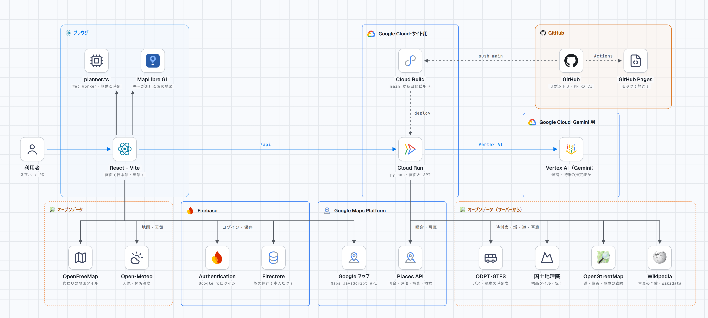

# DevFest GDGoC Japan 2026 Hackathon 提出ドキュメント

> 提出した説明ドキュメント（Google ドキュメント）と同じ中身。9 は、Google ドキュメントの側に各自が書いた。

## チーム情報

- 会場： 東京
- チーム名： いいおゼミ
- メンバー： @v76nl（リーダー）／@Omupp／@Shichimi555／@karinkamonohashi

## アプリケーション名「IntenTrip」

- カテゴリ： 観光
- GitHub リポジトリ URL： https://github.com/Devfest-Hackathon-2026/df-2026-t080

## 【必須項目】

### 1. プロジェクト概要

IntenTrip は、**行く時間と場所をずらして混雑を避ける、日帰り〜1 泊の旅の 1 日を組む**ウェブアプリです。AI（Gemini）が候補を注意点つきで出し、人が理由を添えて選び、時刻と順番は規則で計算します。

- 開くと、自分の旅のホーム画面が出ます。新しい旅は、いきなり答えを出さず、**行きたい場所を自分で選ぶ**ところから始まります。
- AI（Gemini）が、実在する候補を、**特徴と注意点（欠点）**つきで出します。人は、欠点を見たうえで、**選んだ理由を一言残して**決めます。
- 混雑を避けた時間割を、規則で組みます（時刻の計算は AI にさせません）。移動は、本物のバス・電車の便と、Google マップへのリンクで示します。
- 旅の最中は、**ミッションと写真**で、一か所をじっくり見る旅にします。旅のあとは、**選んだ理由と写真を、1 枚のカードにして振り返り、画像で保存できます**。

テーマ「Own the Why, Build with Intent」を、「AI の提案を鵜呑みにせず、人が理由を持って選ぶ」体験として、製品の中心に置いています。

### 2. 解決する課題

#### 2-1. 対象ユーザー

**日帰り〜1 泊の旅行者（学生・若年層が中心）。** 有名な場所に行きたいが、混雑で疲れ、穴場を調べる時間も取りにくい人。
私たちのチームが学生で、同じ立場で、実際に困る場面を知っています。

#### 2-2. 課題と根拠

- **旅行者が、一部の地域・時間帯に集中している。** 2025 年の訪日外客数は 42,683,600 人（前年比 +15.8%）で過去最多（JNTO）。
- **その集中で、住民の生活と旅行者の満足度への影響が懸念されている。** 国は、「観光客が集中する一部の地域や時間帯等によっては、過度の混雑やマナー違反による地域住民の生活への影響や、旅行者の満足度低下への懸念が生じています」としている（観光庁）。2023 年 10 月 18 日には、観光立国推進閣僚会議が「オーバーツーリズムの未然防止・抑制に向けた対策パッケージ」を決定した。国の支援は、京都市を含む 26 地域に及ぶ。京都市は、市民利用と観光利用の棲み分けを目指して、観光特急バスを運行している。
- **旅行者の側では、混雑で困った人の 41% が、原因を「混雑や渋滞等の情報が発信されていない・情報量が不足」と答えている**（観光庁の 2024 年度調査。訪日外国人が対象）。世界の旅行者の調査では、過去 12 か月に、サステナビリティ関連の問題を理由に特定の旅行先を避けた人が 43〜61% で、最大の要因は「人混み」だった（報道による）。
- **若年層は、時間をかけずに旅先を決める傾向がある**（Z 世代は旅行計画でも「タイパ」を意識。決め手が SNS の人が 42%）。

出典（取得日 2026-11-06。各数字は、出典のページを開いて該当の記述を確かめたもの）:

| # | 数字・記述 | 出典 | 確かさ |
|---|---|---|---|
| 1 | 一部の地域・時間帯への集中による、地域住民の生活への影響と、旅行者の満足度低下への懸念。2023 年 10 月 18 日、観光立国推進閣僚会議が対策パッケージを決定 | 観光庁「オーバーツーリズムの未然防止・抑制に向けた取組」 https://www.mlit.go.jp/kankocho/seisaku_seido/kihonkeikaku/jizoku_kankochi/jizokukano_taisei/overtourism.html | 一次（国） |
| 2 | 2025 年の訪日外客数 42,683,600 人（前年比 +15.8%） | JNTO「訪日外客数（2025 年 12 月推計値）」 https://www.jnto.go.jp/news/press/20260121_monthly.html | 一次。推計値 |
| 3 | 困った要因は「混雑や渋滞等の情報が発信されていない・情報量が不足」（都市部・地方部とも 41%） | 観光庁「訪日外国人旅行者の受入環境に関する調査を実施しました」（令和 7 年 4 月 18 日） https://www.mlit.go.jp/kankocho/news08_00022.html | 一次（国）。対象は訪日外国人 |
| 4 | 京都市が、市民利用と観光利用の棲み分けを目指して、観光特急バスを運行（2024 年 6 月〜） | 京都市「オーバーツーリズム対策としての観光客専用バスの導入」 https://www.city.kyoto.lg.jp/sogo/page/0000348549.html | 一次（自治体） |
| 5 | 先駆モデル地域型で 26 地域を選定（京都府京都市を含む） | 観光庁（1 と同じ）、事例集 https://www.mlit.go.jp/kankocho/jirei_shien/overtourism.html | 一次（国） |
| 6 | 過去 12 か月に、サステナビリティ関連の問題を理由に特定の旅行先を避けた人が 43〜61%。最大の要因は「人混み」 | トラベルボイス（フォーカスライト社の調査の翻訳・編集、2024 年 1 月） https://www.travelvoice.jp/20240115-154925 | 二次（報道）。世界の旅行者の調査 |
| 7 | Z 世代は旅行計画でも「タイパ」を意識。旅先決定の決め手は SNS が 42% | トラベルボイス（スカイスキャナーの調査、2024 年 8 月） https://www.travelvoice.jp/20240823-156210 | 二次（報道） |

確認の状況（確認できなかった数字を含む）は、GitHub リポジトリの `docs/problem-evidence.md`。

**限界（正直に）**: 国内の学生・若年層が「混雑で疲れる」と感じる割合を直接示す数字は、見つけられていない。

そのため、国・自治体の資料（1〜5）を主な根拠にし、若年層の数字（7）は補助にとどめた。

#### 2-3. 既存手法との違い

（一般的な旅行ガイド・地図アプリとの比較。個別のサービスを、網羅的に比較したものではありません。）

- 地図や旅行ガイドは、場所の情報と経路を示します。**混雑を避けて、旅程の順番と時間を組む**ところまでは、旅行者が自分で行います。
- AI の旅程づくりは、答えを一つ出して終わるものが多く、**なぜそれを選ぶのかが、人の手に残りません。**
- IntenTrip は、**複数の候補を、欠点つきで出し、人が理由を添えて選ぶ。** 選んだ理由を残し、旅のあとに振り返る。AI が提案し、人が決める、という役割分担を、製品の形にしています。
- 同じ「観光」でも、**行き先を増やす方向（謎解きなど）ではなく、混雑を避けて、時間と場所を分ける方向**です。

### 3. Google 技術の活用

#### 3-1. 使用した Google 技術（少なくとも一つ選択）

- [ ] App Engine
- [ ] Compute Engine
- [ ] Google Kubernetes Engine（GKE）
- [x] **Cloud Run**
- [ ] Firebase App Hosting
- [ ] Firebase Hosting

#### 3-2. Google 技術の活用例

| 技術 | 使い方 |
|---|---|
| **Cloud Run** | 画面と API を 1 つのコンテナで配信（`Dockerfile`）。`asia-northeast1`、最大 1 台、リクエストの処理中だけ課金 |
| **Vertex AI（Gemini）** | ① 実在する候補を、特徴と注意点つきで出す。② 時間帯ごとの混雑を推定する。③ 「最後は嵐山に寄りたい」のような頼み（「Gemini に頼む」）を、画面の操作に置き換える（頼みで触れていない場所は足さない・外さない）。④ 場所に合わせたミッションを作る。⑤ 乗換案内のスクリーンショットから、路線・時刻・運賃を読み取る。⑥ プランに合わせて、その日の注意を 3〜5 行で書く（ペンギンの一言。添える勧めは、予約・服装・足元・日の入り・混雑の 5 つの型だけ）。Cloud Run のサービスアカウントで認証し、鍵は持たない |
| **Maps JavaScript API** | 地図の描画（キーがあるとき） |
| **Places API (New)** | Gemini が出した候補の照合（位置と場所の種類。コンビニ・銀行・事務所・金券ショップなど、名所でない店と分かった見どころは候補から外す）。候補の写真・評価・営業時間（Google マップが地図のときだけ表示）。本番で有効（2026-11-07 に、本番の「この付近を検索」が Places の結果を返すのを確かめた） |
| **Firebase Authentication・Cloud Firestore** | Google のログイン（任意）と、旅のクラウド保存。本人の uid の下だけ読み書きできるセキュリティ ルール（`firestore.rules`）。Firestore に入れるのは、uid と旅の中身だけで、名前・メールアドレスは保存しない。2026 年 11 月 10 日に、本番で Google のログインと旅の保存が動くのを確かめた |
| **Cloud Build** | `main` に入ると、組み立てて Cloud Run に置き直す |

#### 3-3. Google 技術を選定した理由

**時刻の計算と、最終的な選択は、AI にさせない**（間に合わないスケジュールを作るため、人の判断を残すため）。そのうえで、次の理由で選びました。詳細は GitHub リポジトリの `docs/tech-choices.md`。

| 技術 | 選んだ理由 | 捨てた案と理由 | 限界 |
|---|---|---|---|
| **Cloud Run** | 画面と API を 1 つのコンテナで配れる。リクエストが無い間は課金されない（最小インスタンス 0）。学生の予算（$20・$300）に合う。サービスアカウントで Vertex AI を呼べる（鍵を置かない） | GKE・Compute Engine: 4 人・数日の開発に対して、運用の負担が大きい。App Engine: コンテナの Dockerfile をそのまま使えるほうが、手元と本番の差が小さい | 最大 1 台（プランを作る仕事の進み具合を、サーバーのメモリに持つため）。多くの人が同時に使うには、状態を Firestore などに移す必要がある |
| **Vertex AI（Gemini）** | プロダクトのメイン技術を Google 技術にする規約に合う。配られたクレジット（$20）は Vertex AI にだけ使える。Cloud Run のサービスアカウントで認証でき、鍵をリポジトリに置かずに済む。Flash 系で、考える量を少なめにすると、1 回が速い | AI Studio のキー: 手元の開発には使う（無料枠）が、本番ではクレジットが使えず、鍵の管理も要る。他社の LLM: Google 技術の活用では評価されない | 混雑・営業時間などの推定は、実測ではなく、間違うことがある。画面に「推定」と出し、Google マップで確認できるリンクを添える。呼び出しに 1 時間あたりの上限を設ける |
| **Firebase**（Authentication・Firestore） | ログインと保存を、自前で作らず、Cloud Run と同じ Google の基盤で、鍵を持たずに済ませる。ログインは任意で、しなくても全部使える（審査員がすぐ試せるように） | 保存を自前で作る案は採らなかった | ログインしない場合は、旅がその端末だけに残る（端末をまたいで開けない） |
| **Maps JavaScript API** | Google のデータで、地図を正確にする。キーが無い環境・キーが通らないときは MapLibre に切り替わり、画面が止まらない | Google マップだけ: キー・料金に依存し、モックと手元で動かない。MapLibre だけ: Google 技術の活用が弱い | 経路の線と移動時間（徒歩・車）は、まだ OSRM（OpenStreetMap）。Routes API への移行は、料金の確認が済んでおらず保留 |
| **Places API (New)** | Gemini が出した候補が実在するか・名所かを、Google のデータで照らせる。写真・営業時間を、Gemini の推定ではなく、Google のデータで正確にできる | Wikipedia の写真と Gemini の推定のまま | 規約に合わせて、Places の内容は Google マップのときだけ出し、保存は `place_id` と緯度経度（30 日まで）に限る。営業時間は場所の画面に見せるだけで、時間割の計算には Gemini の推定を使っている |

### 4. アーキテクチャ図

利用者（スマホ・PC）→ 画面（React）→ Cloud Run（Python）→ Vertex AI（Gemini）。回る順番と時刻の計算は、画面の中（web worker）で行う。ログインと旅の保存は Firebase（Authentication・Firestore）、地図と場所の照合・写真は Google Maps Platform（Maps JavaScript API・Places API）。補助のデータは、ODPT・GTFS の時刻表、国土地理院の標高タイル、OpenStreetMap（道・位置・電車の路線）、Wikipedia、Open-Meteo。`main` に入ると、Cloud Build が組み立てて Cloud Run に置き直す。

Google Cloud の製品は公式アイコンで描いた（Cloud Run・Vertex AI は製品のアイコン、Cloud Build・Firestore・Google Maps Platform は分類のアイコン）。原寸とダーク版は、GitHub リポジトリの `docs/architecture.png`・`docs/architecture-dark.png`。

### 5. プロジェクトをデプロイした URL

https://intentrip-29919508404.asia-northeast1.run.app/

2026 年 11 月 14 日（土）の終わりまで、提出の締切の時点の状態のまま動かし続けます（締切のあとは、再デプロイ・設定の変更をしません）。

## 【任意項目】

### 6. 動作確認の方法

#### 6-1. テストアカウント情報

**ログインは不要です**（ログインしなくても、全部の機能を使えます）。Google のログインは任意で、すると旅がクラウドに保存され、別の端末でも開けます。

#### 6-2. 動作確認手順

1. 上の URL を、スマホまたは PC で開く。ホーム画面の「京都のデモを試す」（ログイン不要）を押すと、京都の例のプラン（時間割。京都駅を 7:30 に出て、清水寺に朝いちばんに入る）が開く。https://intentrip-29919508404.asia-northeast1.run.app/?example を開いても同じ。地図の下に「今は京都の例です。」と「自分の旅を作る」が出る。
2. スケジュールの「場所を足す・外す」で候補の一覧を開き、候補を押す。**特徴と注意点**と、混雑する時間帯（Gemini の推定）が出る。**理由**（定型の選択と一言）を入れて、「プランに入れる」。選んだ場所を入れて、時間割が組み直される。
3. 電車・バスの区間の行の下の「便を見る ›」などを押すと、バス・電車の便と、Google マップへのリンクが出る。
4. 場所の画面で、**ミッション**が出る。写真を撮って記録する。旅を振り返る（振り返りカード）と、選んだ理由と写真を並べた画像を保存できる。見出しの「共有」から、地図とスケジュールの画像も保存できる。
5. （ホーム画面の「新しい旅を作る」を押し、「行き先の駅か地名」に日本の駅名か地名（例: 鎌倉駅）を入れて「候補を探す」を押すと、Gemini を呼んで候補を作る。20〜25 秒かかる。候補が届くと、「行きたい場所を選んでください」の画面から始まる。費用の歯止めとして、1 時間あたりの呼び出しに上限がある。）

#### 6-3. サンプルデータ

ホーム画面の「京都のデモを試す」で出る**京都の例**（`server/sample.json`。京都駅を 7:30 に出て、清水寺・白川一本橋・花見小路通・法住寺を回り、15:00 までに戻る）。
ほかのエリアは、入れたときに候補を作る（6-2 の 5）。鎌倉・奈良・大阪などのバス・電車の時刻表が無いエリアでは、地図データ（OpenStreetMap）の路線と駅から、乗り換えなしの電車の目安（路線・乗る駅・降りる駅・約何分）を出します。発車の時刻は出ません。

### 7. アプリの詳細や機能に関する自由記述

#### 7-1. 主な機能

- 行き先の駅か地名を入れて、行きたい場所を選んで始める／候補の特徴と注意点／選んだ理由の記録／名所でない店（コンビニ・銀行・事務所・金券ショップなど）を、Places の照合で候補から外す
- 混雑を避けた時間割（一日の最後を落ち着いた場所で終える・ゆとり・旅の前の「楽しみ」）
  - 効果の確かめ（推定どうしの比べ・実測ではない）: 入力画面の行き先の例の 8 エリア（鎌倉・浅草・横浜・箱根・日光・京都・奈良・金沢）で、曜日・出発の時刻・帰る時刻を変えた 128 通りのプランを、同じ場所を近い順に回る「よくある回り方」と比べた。混雑と推定される時間帯の滞在（Gemini の推定）は、1 プランごとの中央値で 34% 減り、平均は 67 分→41 分（−40%）。減ったのは 50%、同じくらいが 45%、長くなったのは 0（よくある回り方が帰る時刻か閉まる時刻を守れない 6 通りは、別に数えた）。8 エリアとも平均では減った（−10%〜−66%）。測れるのは回る順と時刻の効果だけ。京都の例のプランが大きく減るのは 7:30 に出て清水寺に朝いちばんに入れるからで、休日に 9:00 以降に出ると同じくらいになる（台本と結果は、GitHub リポジトリの `submission/eval/`）
  - 推定そのものの確かめ: 京都の 5 地点（清水寺・花見小路通・錦市場・伏見稲荷大社・嵐山竹林の小径）で、Gemini の推定を、京都市観光協会の「京都観光快適度マップ」の 2026 年 11 月 14 日（土）・晴の予測と照らした。混雑かどうかは、8〜18 時の 55 コマ中 44 コマ（80%）で一致し、合わないのは主に夕方（推定のほうが早く空くと見ている）。予測と推定の比べで、実測ではない。相手の値は転載していない（`submission/eval/crowd-check.md`）
- 「Gemini に頼む」（自然な言葉でプランを調整。頼みで触れていない場所は足さない・外さない。探した店は、プランの近くから選ぶ。移動が 30 分以上増えたら知らせ、元に戻せる）／入れ替える前の確認／希望に名指しした場所（「太宰府に行きたい」など）は必ずプランに入れる
- バス・電車の便と目安時間（ODPT）・途中の停留所（区間の行の下の「便を見る ›」）／時刻表の無いエリアは、OpenStreetMap の路線と駅から乗換なしの電車の目安／区間ごとに徒歩か電車・バスかを選ぶ／Google マップのリンク／乗換スクリーンショットの取り込み
- ミッション（最初に難しさを選ぶ）と写真／天気と服装の目安／ペンギンの一言（プランに合わせた、その日の注意を Gemini が 3〜5 行で書く。添える勧めは、予約・服装・足元・日の入り・混雑の 5 つの型だけ）
- Google の写真・評価・営業時間（Places）／地図に写っている範囲の店などを探す「この付近を検索」（Places。結果は保存しない。候補にある店はプランに入れられる）
- 旅のあとの振り返りカード（選んだ理由と写真）／地図とスケジュールを 1 枚の画像で保存して共有
- 地図に、乗る区間を路線の色、歩く区間を道に沿った点の線で描き、乗る駅・降りる駅に印と名前を出す／徒歩の区間の距離と坂（なだらかな上り など）
- 画面・Gemini の文・例のプランの、日本語と英語の切り替え（外国人の旅行者にも使える）
- ホーム画面（自分の旅の一覧・開く・作る・消す。「京都のデモを試す」で例のプラン）。**Google のログイン（任意）**で、旅をクラウドに保存し、別の端末でも開ける

**一部だけのもの・確かめていないもの（正直に）**（詳細は GitHub リポジトリの `docs/implementation-status.md`）:

- バス・電車の本物の便は、時刻表があるエリアのみ。無いエリアは、電車は OpenStreetMap の路線と駅からの目安（発車の時刻は無い。乗換なしの 1 路線のみ）、バスは式の目安。
- 営業時間は、Gemini が候補を出すときの推定で、実測ではない（取れなかった場合は 9:00〜17:00）。画面の閉まる時刻などには「（目安）」を付けた。
- 振り返りカードと、地図とスケジュールの画像は、iPhone 実機での共有・保存が未確認。

**安全性・保守性の作り**:

- キー・トークンを、リポジトリに入れない（`.env` は git に入れない。全履歴を確認した）。
- Gemini・Places・時刻表の呼び出しに、1 時間あたりの上限（費用の歯止め）。予算アラートは通知だけで止まらないため、止める手段として入れた。
- リクエストの大きさの上限、`place_id` などの形式の検証、Gemini の返す操作の検証。
- Gemini・Places・時刻表が使えないとき、今までの動作に戻る。
- PR で、画面の型チェックとビルド、サーバーの構文、Dockerfile の組み立てを CI で確かめる。
- 限界: 最大 1 台（ジョブの状態はメモリ、作り置きはファイル）。構造化ログ・稼働監視は未実装（標準出力のログは Cloud Run に出る）。

#### 7-2. 今後の展望

- 時刻表が無いエリアの本物の便（今は、電車は地図データの路線と駅からの目安、バスは式の目安だけ）と、経路・位置確認の Google 化（Routes API ほか。料金を確かめながら）。
- 状態（プランを作る仕事の進み具合・作り置き・回数の上限）を、Firestore などに移し、複数台で動かせるようにする（旅の保存は、すでに Firestore）。
- 混雑の推定を、公開の予測や実測と照らして直す。京都の 5 地点・1 日分は照らした（55 コマ中 44 コマが一致）。残りは、合わなかった夕方の推定を直すことと、ほかのエリア・ほかの日での照合。
- 稼働監視・構造化ログ。日本語・英語以外の言語。

## 【採点外項目】

### 8. AI をどの場面でどう使用したか、なぜその場面で使用したか

- **製品の中**（Gemini）: 候補・混雑の推定・頼みの解釈・ミッション・画像の読み取り・ペンギンの一言。**時刻の計算と、最終的な選択は、AI にさせない。** AI が作った文には、記号を付ける。
- **開発**（Claude Code ほか）: 実装・調査・文書の下書き。開発用リポジトリの 1,054 コミットのうち 838 に、AI との共作の記録がある（2026-11-09 時点）。**小さな PR に分け、採用・却下の理由を残し、作者と別の人がレビューし、数字と出典は原資料で確かめる**決まりで使った。
- **複数案を比べて、人が選んだ場面**（公共交通機関の取得、始まり方、費用の設定ほか）と、**AI の誤りを直した例**を、選んだ案・捨てた案・理由つきで残した。

詳細は GitHub リポジトリの `docs/ai-usage.md`（Gemini に送るプロンプトは `docs/prompts.md`）。

#### 製品の中の AI（Gemini・Vertex AI）

| 場面 | 何をさせるか | なぜ AI か | AI に任せないこと（人・規則が決める） |
|---|---|---|---|
| 候補の収集 | エリアと希望から、実在する場所の候補を、特徴と注意点（欠点）つきで出す | 旅行者が自分で調べる時間を省く。「穴場」の候補は、検索だけでは見つけにくい | どの候補を選ぶか。実在の確認（Places・位置の照合。名所でない店と分かった見どころは外す） |
| 混雑の推定 | 時間帯ごとの混み具合を推定する | 実測の混雑データは、全国の場所に対して無い | 推定は実測ではない。画面に「推定」と出し、Google マップで確認できる。京都の 5 地点で公開の予測と照らした（`submission/eval/crowd-check.md`） |
| プランへの頼み（「Gemini に頼む」） | 「最後は嵐山に寄りたい」「もっとゆっくり」を、画面の操作（最大 8 個）に置き換える | 自然な言葉で調整できる | 操作は、画面側が検証して実行する（Gemini が時刻や順番を直接決めない）。頼みで触れていない場所は足さない・外さない。移動が 30 分以上増えたら知らせ、元に戻せる |
| 旅のミッション | その場所に合わせた、写真を撮るミッションを 1 つ考える | 場所ごとの文を、手で作りきれない | ミッションを出す場所の選び方・回数は規則。例は、人が書いた 25 個 |
| 乗換スクリーンショットの読み取り | 画像から、路線・駅・時刻・運賃を読む | 事業者の経路 API が使えない区間を、利用者が自分で取り込める | 読み取りの結果を、利用者が確認して使う |
| ペンギンの一言 | プランに合わせて、その日の注意を 3〜5 行で書く | 場所・時刻・天気の組み合わせごとの文を、手で作りきれない | 添える勧めは、予約・服装・足元・日の入り・混雑の 5 つの型だけ（頼みの文で決めた） |
| 時刻の計算・回る順番 | Gemini にさせない（`web/src/lib/planner.ts` が規則で行う） | AI に任せると、間に合わないスケジュールを作る | — |

#### 開発での AI（Claude Code、Antigravity）

| 項目 | 内容 |
|---|---|
| 使ったもの | Claude（Claude Code）: 実装・調査・文書・レビューの補助。Google の Antigravity: ファビコンとアプリアイコンの生成 |
| 規模 | 開発用リポジトリの 1,054 コミット（マージを含む）のうち 838 に、Claude との共作の記録（`Co-Authored-By`。2026-11-09 時点）。主な使い手は、試作から機能の大半を作った @Omupp。ほかに、@v76nl が、文書・CI・機能の一部・レビューに使った |
| どの場面で使ったか | ① 試作の Web とサーバーの作成と、機能の追加。② 調査（公共交通機関の候補の検証、社会課題の根拠の出典の確認、旅と幸福の研究の出典の確認）。③ 文書（README、計画、技術選定、PR の説明）。④ レビュー（費用と規約の点検）。⑤ 道具（起動スクリプト、CI、API の呼び出しのログ） |
| なぜその場面か | 4 人・約 6 日という時間で、広い範囲（画面・サーバー・Google Cloud・文書）を作るため。実装の手数が多く、仕様が決まっているものに使うと、効果が大きい |
| 使い方の決まり | ① 小さな PR に分け、PR ごとに「完了の条件」を書いてから頼む。② AI が出した案を、採用した理由・却下した理由を、PR の説明に残す。③ PR は、作者と別の人がレビューする。④ CI が通ることを、マージの条件にする。⑤ AI が書いたコメントには、印を付ける。⑥ 数字・出典は、AI に作らせず、原資料で確認する（確認できないものは「未確認」と書く） |

#### 複数案を比べて、人が選んだ場面（Own the Why の実践）

| 場面 | 選んだ案 | 捨てた案と理由 | 決めた人・記録 |
|---|---|---|---|
| プロダクトの方向（AI が 20 件ほどの案を出した） | 旅をメインに、複数案を 1 つの流れに統合（出発前→行き先決め→旅の最中→旅のあと） | 医療・福祉系: 誤情報の責任が重く、チームが「手を出すのが怖い」と判断。単独の案（推し活など）: 旅の流れに統合して残した | @v76nl・チーム（`data/idea.md`・`data/theme.md`） |
| 公共交通機関の取得 | ODPT の時刻表（出典の表示で使える公開データ） | 駅すぱあと: 無料は公開の作品に使えず、有料は時刻の使い回しと AI への入力が禁止。個人公開の API: JR が欠け、京都駅→伏見稲荷が 34 分（実際は約 5 分）。OpenTripPlanner: 重い。Gemini の推定: 作り話の危険 | @Omupp（PR #38・#52） |
| 始まり方（開いたときの画面） | 行きたい場所を先に選ぶ（#43） | 開くと例のプランとルートが出る形: 何をするアプリか分かりにくい（#24）。試作を見比べて、「自分で決めた感がある」ほうを選んだ | @Omupp・メンバーの指摘（issue #24、PR #42・#43） |
| 「ゆっくり」を既定にするか | 既定は「ふつう」（ゆとり 10 分）のまま。「ゆっくり」は選べる | 「ゆっくり」を既定にすると、立ち寄りが 6.9→4.8 か所、人気の見どころが 3.1→1.7 か所に減る | @Omupp（PR #44） |
| Cloud Run の費用の設定 | CPU はリクエストの処理中だけ（最大 1 台） | 常時割り当て: 1 台で 1 日あたり約 1.7 ドル。クレジットが続かない | @Omupp・@v76nl（PR #4・#7） |
| Places の費用の歯止め | 低め（60 回/時）から始め、クォータで止める手段も設ける | 既定（300 回/時）のまま: 認証なしで誰でも呼べる API に、課金の暴走を許す | @v76nl・@Omupp（Claude のレビューを受けて。PR #17） |
| 地図 | キーがあれば Google マップ、無ければ MapLibre | Google だけ: モック・手元で動かない。MapLibre だけ: Google 技術の活用が弱い | @Omupp（PR #14） |

#### AI の提案を採らなかった例・AI の誤りを直した例

- **AI Studio のキーを、どのプロジェクトに紐づけるか**: Claude は、課金に巻き込まれないよう「新しいプロジェクトで作る」ことを勧めた。v76nl は、料金プランが無料枠であることを確かめたうえで、既存のプロジェクトに紐づけた。
- **医療・福祉の案**: Claude が出した複数案のうち、医療・福祉系は、チームの判断で、手を出さないことにした（安全面の懸念）。
- **文書の誤り**: Claude が書いた「予算の画面で上限を付けると Cloud Run が止まる」という説明は、不正確だった。Claude 自身のレビューで指摘し、@Omupp が PR #13 で直した（予算は通知だけで止まらない）。
- **二重の修正**: Claude が入れたページ位置の修正と、@Omupp の修正が重なり、閉じたときにページが先頭へ飛ぶ恐れがあった。Claude が重なりに気づいて、自分の分を外した。
- **締め切りの誤り**: 文字起こしの要約で「17:00」とされていた締め切りを、運営の資料の原文で 19:00 と確かめて、全文書を訂正した。
- **作り話の危険**: 数字は原資料の該当箇所を開いて確認する決まりにした。確認できなかったものは「未確認」と書く。

### 9. 自分たちが開発を通して何を得て、どれくらい成長できたのか

各自が、提出した説明ドキュメント（Google ドキュメント）に書いた。
